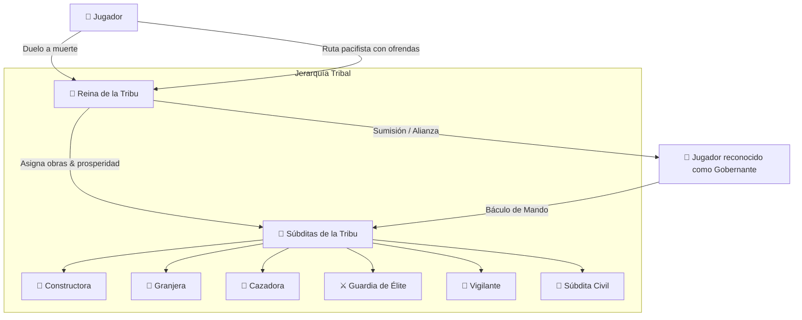

# 🏰 New Colleague Mod — Estado del Proyecto, Arquitectura y Hoja de Ruta

> **Versión de Minecraft:** NeoForge 1.21.1 / 26.2 & 26.3  
> **Motor de Animaciones:** GeckoLib 4  
> **Entidad Principal:** Kobold Girl (`kobold_girl`)  
> **Última Actualización:** 2026-10-23  

---

## 📖 1. Visión General del Proyecto

**New Colleague Mod** transforma la experiencia de supervivencia en Minecraft introduciendo una sociedad viva, interactiva y dinámica de **Kobold Girls**. Lejos de ser simples mascotas o aldeanos estáticos, las kobolds forman una civilización tribal con jerarquía propia, economía real de materiales, progresión de aldeas autónomas, combates rituales de honor y una relación profunda con el jugador a través del **Báculo de Mando**.

---

## 🏛️ 2. Jerarquía Tribal y Mecánicas Sociales



### 👑 La Reina de la Tribu (`Queen`)
- **Liderazgo:** Cada tribu cuenta con una Reina única con nombre propio y título real.
- **Prosperidad y Rangos de Aldea:** Administra el nivel tribal (`VillageTier`), acumulando prosperidad según los oficios activos de sus súbditas y las ofrendas recibidas.
- **Reina Superviviente y Reencarnación:** Si la Reina fallece, sus súbditas recuerdan su legado y pueden iniciar rituales de reencarnación mediante el alma preservada (`QueenSoulTracker`).
- **Disciplina Civil:** Defiende el orden tribal; si una súbdita se rebela, la Reina leal puede aplicar un puñetazo disciplinario desarmado no letal para calmarla.

### 🦎 Oficios y Especializaciones Implementadas
| Profesión | Rol Principal | Comportamiento & Armamento |
| :--- | :--- | :--- |
| **🔨 Constructora (`BUILDER`)** | Expansión urbana y obras | Terraformación, nivelado, cimientos, recolección en cofres o naturaleza, crafteo y edificación capa por capa. |
| **🌾 Granjera (`FARMER`)** | Agricultura y sustento | Labranza de tierra arada, siembra de semillas/zanahorias, cosecha y aporte continuo a la prosperidad. Pacífica. |
| **🏹 Cazadora (`HUNTER`)** | Caza y recolección | Caza de fauna salvaje para abastecer carne y alimento a la tribu. Pacífica con aliados. |
| **⚔️ Guardia (`GUARD`)** | Defensa cuerpo a cuerpo | Solo usa armas melé pesadas (espadas, hachas, mazas). Custodia campamentos y combate a corta distancia. |
| **🎯 Vigilante (`VIGILANT`)** | Defensa a distancia | Especializada en arcos y ballestas con recarga y munición. Vigila desde torres y perímetros. |
| **🎒 Civil (`NONE`)** | Base demográfica | Realiza tareas auxiliares y puede ser asignada a cualquier rol según las necesidades del asentamiento. |

* **Niveles de Maestría (Tier 1 y Tier 2):** Las súbditas que alcanzan el Tier 2 obtienen un 20% de reducción de daño permanente y acceso a armamento avanzado.

---

## 🏗️ 3. Sistema de Expansión Urbana y Construcción Real

A diferencia de otros mods donde las estructuras aparecen instantáneamente, en **New Colleague Mod** la construcción es un proceso **100% físico, simulado y con economía real**:

### 📐 Ciclo de Construcción Inteligente
1. **Planificación Urbana No Solapada (`VillagePlot`):**
   - El sistema explora el terreno en anillos concéntricos (8 a 42 bloques del centro).
   - Verifica márgenes de seguridad para calles (2 bloques de separación).
   - Evita agua, lava, construcciones preexistentes y pendientes pronunciadas (> 3 bloques).
2. **Terraformación y Nivelado:**
   - **Despeje:** Excava montículos, hierba alta y troncos que obstruyan el área. Los bloques removidos ingresan a su inventario (tierra, piedra, madera).
   - **Relleno:** Detecta huecos o caídas de terreno y los nivela con tierra para crear una base plana sólida.
3. **Economía Real de Materiales:**
   - Cada bloque colocado consume exactamente 1 ítem del inventario de la constructora.
   - **Cofres Comunales (`FETCHING_FROM_CHEST`):** Si le falta un material, busca en cofres y barriles comunales en un radio de 24 bloques y lo extrae.
   - **Recolección en la Naturaleza (`GATHERING_FROM_NATURE`):** Si no hay en cofres, tala árboles para madera, pica piedra para adoquín o recoge semillas.
   - **Crafteo In-Situ:** Transforma troncos en tablones, vallas, losas, camas o fogatas.
   - **Espera Activa (`WAITING_FOR_MATERIALS`):** Si requiere un ítem exótico (linterna, lana, cama) que no puede recolectar a mano, emite partículas de humo pensativo y avisa a la Reina y al jugador en el censo. En cuanto depositas el ítem en un cofre comunal, reanuda la obra al instante.
4. **Construcción por Capas (Y Ascendente):**
   - Todos los blueprints se construyen estrictamente desde el suelo (Y=0) hacia arriba (paredes, techos y linternas), evitando bloques flotantes.
   - Cuenta con alcance vertical 3D para edificar techos y torres sin atascos.

### 🏛️ Estructuras Disponibles
- **Campamento Central (`CAMPFIRE_BASE`):** Fogata central, asientos de troncos, caminos de tierra y antorchas esquineras.
- **Tienda de Campaña (`TENT`):** Estructura nómada de lana multicolor con cama roja y linterna interior.
- **Granja Comunal (`FARM`):** Sistema de regadío central, tierra arada fértil, cultivos y vallas protectoras con portón.
- **Depósito de Suministros (`STOREHOUSE`):** Almacén techado con cofres para la gestión comunal de recursos.
- **Torre de Guardia (`WATCHTOWER`):** Estructura defensiva elevada para vigilancia y tiro con arco.

---

## 💬 4. Interacción, Diálogos y Sistema de Conquista

Al interactuar con la Reina se despliega una interfaz visual interactiva (`QueenDialogueScreen`):

### ⚔️ Ruta de Dominancia (Duelo por el Trono)
- **Desafío:** El jugador desafía formalmente a la Reina a un combate ceremonial a muerte con cuchillos.
- **Arena de Duelo:** Las súbditas forman un círculo místico de espectadoras invulnerables, canalizando partículas y encerrando a los combatientes dentro de una barrera.
- **Victoria:** Al llegar la Reina a 2 HP, el combate cesa, reconoce la fuerza del jugador y le jura lealtad como nuevo Gobernante de la tribu.
- **Lealtad de las Súbditas:** Las trabajadoras civiles (constructoras y granjeras) permanecen siempre leales y en postura de trabajo. Ciertas súbditas combatientes pueden rebelarse, dando profundidad a la conquista.

### 🤝 Ruta Pacifista (Prosperidad por Ofrendas)
- Si el jugador prefiere no derramar sangre, puede ganarse el respeto tribal mediante ofrendas comerciales de carne cruda para alimentar a la tribu.

### 📋 Gestión de la Aldea
- **Menú de Expansión:** Estado detallado del proyecto actual (% de avance o terraformación) y materiales faltantes.
- **Censo y Reporte:** Desglose exacto de población por profesión, prosperidad acumulada y rango del asentamiento.
- **Órdenes Generales:** Convocar a todas las súbditas a seguirte, trabajar o custodiar sus puestos.
- **Recaudación de Tributos:** Recoger recursos excedentes recolectados por las súbditas leales.

---

## 🪄 5. El Báculo de Mando (`BaculoItem`)

El báculo es la herramienta principal del jugador para gobernar a su tribu:

- **Posturas de Mando (`CommandStance`):**
  - **`WORK` (Trabajo):** Las constructoras edifican, las granjeras cultivan y las cazadoras recolectan.
  - **`FOLLOW` (Seguir):** Las súbditas seleccionadas siguen al jugador como escolta personal.
  - **`GUARD` (Guardia):** Las súbditas defienden una posición fija designada en el mundo.
- **Rangos del Báculo:**
  - **Nivel 1:** Mando básico individual y grupal.
  - **Nivel 2 (Pizarra Profunda):** Desbloqueado automáticamente al vencer a la Reina en duelo de dominancia. Otorga mayor radio de mando y capacidades mágicas defensivas.
- **Lanzamiento Mágico:** Canalización de bolas de fuego para apoyo táctico en combate.

---

## 🛠️ 6. Últimas Correcciones y Optimizaciones Aplicadas

| Problema Identificado | Causa Raíz | Solución Implementada |
| :--- | :--- | :--- |
| **Constructora no terminaba de construir tras un duelo con la Reina** | La constructora se alertaba por daño hostil (`alertOther`), adquiriendo al jugador como objetivo de combate persistente (`isThreatened = true`). Además, al terminar el duelo, podía convertirse en rebelde por azar. | Se blindó a las constructoras para ignorar alertas bélicas; se aseguró limpieza de objetivos al concluir el duelo; se garantizó que constructoras y granjeras **nunca** se rebelen y queden fijadas en `CommandStance.WORK`. |
| **Constructora atascada mirando hacia techos altos** | El chequeo de distancia solo evaluaba distancia 3D estricta (`<= 3.5 bloques`), impidiendo alcanzar techos de tiendas (Y=3) o torres desde el suelo. | Se separó la distancia horizontal (`<= 3.5`) del alcance vertical (`<= 5.0`), permitiendo construir capas superiores desde el suelo. |
| **Solicitud de materiales duplicados** | Si una obra se pausaba a mitad, no se reconocían los bloques ya colocados previamente. | Se agregó un bucle de avance rápido (`fast-forward`) que valida los bloques ya existentes en el mundo y salta al siguiente pendiente. |
| **Bloques colocados en orden inverso** | Algunas estructuras colocaban antorchas, fogatas o techos antes de los cimientos inferiores. | Se añadió un ordenamiento estricto por altura (`relY` ascendente) en el generador de blueprints. |

---

## 🎯 7. Estado de Archivos del Código Fuente

- 📁 `com.newcolleague.mod.entity`:
  - `KoboldGirlEntity.java`: Núcleo de IA, animaciones GeckoLib, combate, jerarquía, posturas y objetivos de comportamiento.
  - `QueenSoulTracker.java`: Registro y preservación de almas de reinas.
- 📁 `com.newcolleague.mod.village`:
  - `StructureBlueprint.java`: Blueprints de 5 tipos de estructuras, mapeo de ítems requeridos y parcelas urbanas (`VillagePlot`).
  - `VillageProject.java`: Estado del proyecto activo, terraformación y control de avance de obra.
  - `VillageTier.java`: Niveles de prosperidad y rangos de aldea.
- 📁 `com.newcolleague.mod.item`:
  - `BaculoItem.java`: Báculo de mando del gobernante.
  - `BaculoEventHandler.java`: Lógica de interacción, selección de súbditas y asignación de órdenes en mundo.
- 📁 `com.newcolleague.mod.client`:
  - `QueenDialogueScreen.java`: GUI interactiva de diálogo con la Reina.
  - `KoboldGirlScreen.java` & `KoboldGirlMenu.java`: Gestión de inventario y equipamiento propio de cada Kobold.
  - `KoboldGirlRenderer.java` & `KoboldGirlModel.java`: Renderizado y animaciones de GeckoLib.
- 📁 `com.newcolleague.mod.network`:
  - `QueenDialogueActionPayload.java` & `OpenQueenDialoguePayload.java`: Red segura cliente-servidor para decisiones de gobierno y diálogos.

---

## 🚀 8. Módulos Faltantes y Hoja de Ruta de Expansión

### A. Ecología Real y Sostenibilidad
1. **Silvicultura Sostenible (Replantación Obligatoria):**
   - Recolección de brotes (*saplings*) y replantación inmediata en la misma zona tras la tala.
   - Regla de abstención de tala si quedan menos de $N$ árboles adultos en el perímetro ecológico de la tribu.
2. **Conservación de Fauna y Ganadería Autónoma:**
   - Regla `DO_NOT_KILL` si la población local de una especie animal es $\le 2$ ejemplares.
   - Alimentación con trigo/zanahorias del inventario para reproducirlos.
   - Caza selectiva permitida únicamente cuando existan $\ge 4$ o $5$ adultos (caza del excedente).

### B. Logística y Cocina de Élite
1. **Especialización Alquimista / Cocinera de Élite (`ALCHEMIST`):**
   - Elaboración de Zanahorias Doradas y Manzanas Doradas procesando pepitas/lingotes de oro con cultivos agrícolas.
   - Cofre de Suministros Médicos/de Guerra dedicado.
   - Consumo inteligente de raciones doradas exclusivamente durante duelos ceremoniales, invasiones o salud crítica ($\le 30\%$).
2. **Organización de Almacenes por Marcos de Ítems (`ItemFrame`):**
   - Clasificación autónoma de depósitos: las súbditas buscan marcos colocados en cofres comunales para depositar según su categoría (comida, minerales, semillas, madera).

### C. Inteligencia de Campo y Exploración Avanzada
1. **Rol de la Exploradora (`SCOUT`):**
   - Mapeo en espiral fuera del asentamiento (radio de 128–256 bloques).
   - Evasión sigilosa (`SNEAK_AND_EVADE`) con agachado y desvío de ruta ante amenazas o monstruos.
   - Registro y entrega presencial del Informe de Campo a la Reina al atardecer para registrar Puntos de Interés (`POIs`):
     - Ubicación de la base/casa del jugador.
     - Canteras y bosques densos ricos en recursos.
     - Asentamientos y tribus rivales con evaluación de población y fuerza defensiva.

### D. Minería Real y Escuadrones Peligrosos
1. **Minería Sustantiva (Sin Trampas) y Herramientas:**
   - Minado físico en bloque real (`level.destroyBlock`), desgaste de durabilidad de picos y fundición real en hornos con carbón.
2. **Escuadrones de Minería en Cuevas (`Hazardous Tasks`):**
   - Reclutamiento obligatorio de 1–2 Guardias de escolta antes de adentrarse en niveles subterráneos o cavernas.
   - Colocación autónoma de antorchas en nivel de luz $< 7$.
   - Retirada táctica coordinada ante baja salud grupal o saturación de enemigos.
3. **Navegación Anti-Caídas Avanzada (`Look-Ahead Checking`):**
   - Comprobación preventiva del siguiente paso para evitar caídas mayores a 3 bloques o precipicios con agua/lava.

### E. Diplomacia Extendida y Guerra Civil
1. **Guerra Civil por Regicidio Ilegítimo (`CIVIL_WAR`):**
   - Si la Reina muere sin duelo oficial o pacto formal, la tribu se desestabiliza en una sangrienta lucha por el trono (`CIVIL_WAR`), donde las súbditas combaten entre sí hasta que la última sobreviviente es coronada Reina.
2. **Comando de Depuración y Reseteo (`/kobold reset`):**
   - Comando administrativo de modo creativo `/kobold reset <tribu_id>` para limpiar Data Attachments del jugador y reiniciar relaciones diplomáticas en pruebas de desarrollo.

---

## 🛠️ 9. Plan de Integración y Arquitectura Técnica en NeoForge

Para mantener la base de código limpia, modular y desacoplada, se distribuyen los nuevos módulos en los siguientes paquetes:

```
src/main/java/com/newcolleague/mod/
├── entity/
│   ├── KoboldProfession.java        <- Nuevos roles: ALCHEMIST, SCOUT, MINER
│   └── ai/                          <- Subpaquete dedicado a tareas de comportamiento (Goals)
│       ├── KoboldEcoLoggingGoal.java
│       ├── KoboldHerdingGoal.java
│       ├── KoboldScoutGoal.java
│       ├── KoboldAlchemistGoal.java
│       └── KoboldCaveMiningSquadGoal.java
├── command/
│   └── KoboldAdminCommand.java      <- /kobold reset <tribu_id>
└── village/
    └── VillageStorageClassifier.java <- Lógica de marcos de ítems en cofres
```

### Paso 1: Nuevos Oficios en `KoboldProfession.java`
```java
public enum KoboldProfession {
    NONE("Civil"),
    BUILDER("Constructora"),
    FARMER("Granjera"),
    HUNTER("Cazadora"),
    GUARD("Guardia"),
    VIGILANT("Vigilante"),
    // Nuevas profesiones de la hoja de ruta:
    ALCHEMIST("Alquimista"),
    SCOUT("Exploradora"),
    MINER("Minera");
    // ...
}
```

### Paso 2: Creación de Custom Goals (IA)

#### 1. Silvicultura y Ganadería Sostenible (`KoboldEcoLoggingGoal` & `KoboldHerdingGoal`)
```java
// En el tick de silvicultura tras talar un tronco:
if (treeCutSuccess) {
    ItemStack sapling = findSaplingInInventory(kobold.getInventory());
    if (!sapling.isEmpty()) {
        world.setBlockState(cutPosition, Block.byItem(sapling.getItem()).defaultBlockState());
        sapling.shrink(1);
    }
}

// En el tick de la cazadora/ganadera:
List<Animal> animals = world.getEntitiesOfClass(Animal.class, kobold.getBoundingBox().inflate(16.0));
if (animals.size() <= 2) {
    // Activar restricción DO_NOT_KILL y alimentarlos con trigo/zanahorias
    tryBreedAnimals(kobold, animals);
} else {
    // Caza selectiva solo del excedente adulto
    huntAdultExcedents(animals);
}
```

#### 2. IA de la Exploradora (`KoboldScoutGoal`)
```java
public class KoboldScoutGoal extends Goal {
    private final KoboldGirlEntity kobold;
    private final Set<BlockPos> discoveredPOIs = new HashSet<>();

    @Override
    public void tick() {
        // 1. Sigilo si hay amenazas cercanas
        if (hasEnemiesNearby()) {
            kobold.setShiftKeyDown(true);
            evadeThreats();
            return;
        }
        
        // 2. Mapeo de POIs (Casa del jugador, vetas ricas, tribus rivales)
        scanChunkPOIs();

        // 3. Regreso al atardecer para entregar el informe presencial a la Reina
        if (kobold.level().isNight() && isNearQueen()) {
            deliverReportToQueen();
        }
    }
}
```

#### 3. Navegación Anti-Caídas (`Look-Ahead Checking`)
```java
public boolean isStepSafe(BlockPos nextPos) {
    if (this.level().isAir(nextPos)) {
        for (int i = 1; i <= 3; i++) {
            BlockPos below = nextPos.below(i);
            BlockState state = this.level().getBlockState(below);
            if (state.is(Blocks.LAVA) || (i == 3 && this.level().isAir(below))) {
                return false; // Evita caídas mortales (>3 bloques) o pozos de lava
            }
        }
    }
    return true;
}
```

### Paso 3: Alquimia y Raciones Especiales (`KoboldAlchemistGoal`)
```java
if (hasIngredientsForGoldenFood(communityChest)) {
    consumeGoldAndApples(communityChest);
    ItemStack goldenApple = new ItemStack(Items.GOLDEN_APPLE);
    depositInSpecialChest(medicalChestPos, goldenApple);
}
```

### Paso 4: Sucesión y Guerra Civil en `KoboldGirlEntity.java`
```java
@Override
public void die(DamageSource cause) {
    super.die(cause);
    if (this.isAnyQueen() && !this.isInPlayerDuel()) {
        // Si no murió en el duelo reglamentario de dominancia, estalla la guerra civil
        this.triggerTribalPowerStruggle(this.level(), this.getTribeName(), this.position());
    }
}
```

### Paso 5: Comando de Depuración y Reseteo (`KoboldAdminCommand.java`)
```java
public class KoboldAdminCommand {
    public static void register(CommandDispatcher<CommandSourceStack> dispatcher) {
        dispatcher.register(Commands.literal("kobold")
            .requires(source -> source.hasPermission(2))
            .then(Commands.literal("reset")
                .then(Commands.argument("tribu", StringArgumentType.word())
                    .executes(context -> {
                        String tribu = StringArgumentType.getString(context, "tribu");
                        ServerPlayer player = context.getSource().getPlayerOrException();
                        KoboldGirlEntity.resetTribeOwnership(player, 64.0D);
                        context.getSource().sendSuccess(() -> Component.literal("Diplomacia y posesión de la tribu '" + tribu + "' reiniciadas correctamente."), true);
                        return 1;
                    })
                )
            )
        );
    }
}
```

---

## 📋 10. Checklist de Implementación

### 🌿 Ecología y Sostenibilidad
- [x] Implementar `KoboldEcoLoggingGoal`: Replantación obligatoria de brotes y veto de tala en bosques escasos ($\le 3$ árboles).
- [x] Implementar `KoboldHerdingGoal`: Flag `DO_NOT_KILL` en fauna local con $\le 2$ ejemplares y reproducción con cultivos.

### 🧪 Alquimia y Logística
- [x] Incorporar oficio `ALCHEMIST` para crafteo autónomo de Manzanas y Zanahorias Doradas.
- [x] Depósito inteligente de raciones de emergencia en el cofre de Suministros Médicos (`ChestCategory.MEDICAL`).
- [x] Clasificación de cofres comunales por Marcos de Ítems (`ItemFrame`).

### 🗺️ Exploración e Inteligencia
- [x] Incorporar oficio `SCOUT`: Mapeo sigiloso, evasión `SNEAK_AND_EVADE` y reporte presencial a la Reina al atardecer.
- [x] Registro de Puntos de Interés (`POIs`): Casa del jugador, vetas ricas y asentamientos rivales.

### ⛏️ Minería Rígida y Seguridad
- [x] Minería sustantiva con consumo de durabilidad de picos y fundición real.
- [x] Escuadrones de minería subterránea con $1$–$2$ Guardias de escolta y antorchas automáticas en luz $< 7$.
- [x] Algoritmo Look-Ahead anti-caídas ($> 3$ bloques o lava) mediante `isStepSafe`.

### ⚔️ Diplomacia y Depuración
- [x] Enlace de muerte ilegítima de Reina al detonador de `CIVIL_WAR` / `TribalPowerStruggle`.
- [x] Registro del comando `/kobold reset [radio|target]` para depuración rápida en entornos de prueba.

### 👑 Cerebro de la Reina y Autonomía Dinámica
- [x] Implementar `QueenRoleManager.java`: Escaneo periódico cada 200 ticks (~10s) de métricas de la tribu (comida $< 12$, defensa perimetral nocturna o invasores en radio 32m, infraestructura activa).
- [x] Reasignación inteligente de profesiones: Promoción dinámica de civiles y cazadoras a `GUARD`/`VIGILANT`, balance de `FARMER`/`HUNTER`, asignación de `BUILDER` y `MINER`.
- [x] Normalización en tiempo de paz: Reincorporación de guardias excedentes a tareas constructivas o civiles durante el día despejado.
- [x] `VillageStorage.java`: Abstracción y cálculo de métricas de almacenamiento comunal (comida total, cofres únicos, materiales y herramientas).

### 🛠️ Auto-Crafteo de Emergencia
- [x] Implementar `KoboldCraftItemGoal.java`: Detección preventiva de herramientas rotas o faltantes (hachas, picos, palas, azadones) para `BUILDER`, `MINER`, `FARMER`, `HUNTER` y civiles.
- [x] Cadena de suministros y pre-requisitos: Conversión in-situ de troncos a tablones y tablones a palos.
- [x] Extracción comunal: Navegación y extracción de adoquín y madera desde cofres del asentamiento en un radio de 24 bloques.
- [x] Crafteo comunal o in-situ: Desplazamiento y uso de la Mesa de Crafteo (`crafting_table`) o ensamblaje de emergencia en el campo.
- [x] Auto-equipamiento en mano principal (`MAINHAND`) y reanudación inmediata del trabajo sin bloqueos de animación.
